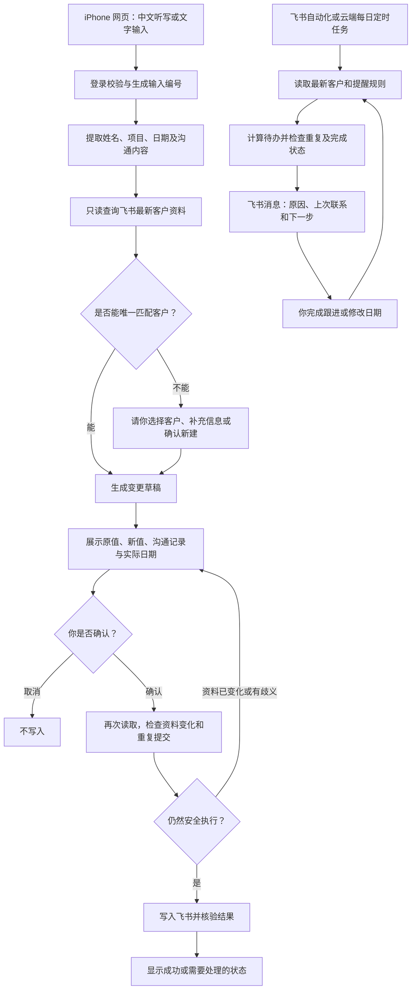

# 房地产 AI 客户管理自动化系统规划

> 2026-10-12 提醒渠道调整：Apple 提醒事项替代飞书聊天消息成为首选任务提醒入口。推荐 iPhone 快捷指令桥接、独立 iCloud 列表和用户发起的状态同步；Mac 无需长期开机。Apple 手动改期不被重新读取飞书覆盖，逾期待办不删除，计划变化须确认。完整方案、平台核实限制及新增验收见 [Apple 提醒事项方案](docs/APPLE_REMINDERS_PLAN.md)。本段优先于下文原有飞书消息建议；阶段 2 仍须先进行模拟开发，不提前开放真实写入。

本文件是阶段 0 的设计成果。只有你确认规划后，才进入阶段 1；后续每个阶段也要测试并单独确认。当前不连接真实客户数据库，不申请写入权限，不部署收费服务。

## 1. 目标与边界

你在墨尔本使用 Mac、iPhone 和飞书多维表格。飞书继续作为唯一正式客户数据库，日常操作不需要打开 Codex、GitHub 或终端。

系统最终提供三个能力：安全读取飞书；中文语音生成客户变更草稿并在确认后写入；每天按客户阶段生成跟进提醒。

GitHub 保存程序和说明，Codex 用来协助开发与维护。Codex Cloud 开发环境不承担全天运行的生产服务，也不作为定时提醒运行平台。

### 当前仓库检查

- 仓库：`rachaelc29/my-first-ai-agent`，本地位置 `/workspace/my-first-ai-agent`。
- 检查时只有 `README.md`，没有应用代码、依赖清单、数据库、测试或部署配置。
- 没有发现 `AGENTS.md`；开始规划前工作区干净。
- 本阶段仅新增本规划，不安装业务依赖、不创建另一套 CRM。

## 2. 方案比较

| 方案 | 适合的部分 | 优点 | 局限与维护 | 费用特点 |
| --- | --- | --- | --- | --- |
| 飞书多维表格自带自动化 | 日期提醒、阶段规则、简单通知 | 最接近现有工作习惯，运行由飞书负责 | 需核实你的套餐、定时触发、跨表规则、消息接收人和去重能力；复杂语音确认流程可能无法完整实现 | 可能包含在现有套餐中，也可能有执行次数或功能限制 |
| 飞书机器人 + 官方 API | 飞书消息入口、客户查询、通知 | 手机直接在飞书操作，不增加另一套 CRM | 需要应用权限、事件处理和消息交互；语音附件下载与转写支持需验证，不能假设机器人自动收到所有语音 | API 配额、云端处理与语音/AI 调用费用 |
| iPhone 手机网页 + 官方 API | 语音录入、匹配、预览、确认 | 确认页面清晰，可保存到主屏幕，容易处理同名客户 | 需要登录、云端后端；Safari 录音权限和文件格式需真机测试 | 小型托管服务 + 可选语音/AI 按量费用 |
| Make | 定时任务、连接服务、原型 | 可视化操作，托管平台负责运行 | 飞书而非国际版 Lark 的连接器适配需核实；复杂确认、重试和去重会增加场景复杂度，数据经过第三方 | 按执行额度或套餐收费，频繁扫描客户会增加用量 |
| n8n | 可视化流程与 API 串联 | 灵活，可自托管 | 自托管需要升级、安全、备份；托管版有订阅费用；飞书连接器覆盖需核实 | 托管订阅或自托管服务器费用 |
| 定制小型程序 | 复杂匹配、明确确认、可靠去重 | 可精准适配现有字段与业务规则 | 开发初期投入较大，仍需依赖升级和故障维护；不能承诺永久免维护 | 可用低用量托管方案，必要时付小额月费 |

### 推荐：飞书原生优先，必要部分使用小型托管程序

1. **阶段 1**：用官方 API 只读检查现有结构，建立“你的字段对应什么含义”的映射，不重建客户表。
2. **阶段 2**：首选 iPhone 网页。先支持键盘上的中文听写，把语音输入变成文字，避免一开始就承担上传音频、保存录音和转写服务费用。网页需要提供普通文本输入作为备用方式。
3. 如听写无法满足长录音、噪声或操作习惯，再增加网页录音上传与语音转写。转写服务是否处理境外数据、是否留存和费用必须先确认。
4. **阶段 3**：先在独立测试表验证飞书自带自动化。如果能满足规则、去重和状态更新，使用原生方案；否则复用阶段 2 后端增加每日定时任务。
5. 提醒优先发到你的飞书个人消息；若当前组织不支持，评估一个只有你的私密群。机器人是否能主动发消息取决于应用类型、权限和接收人范围，阶段 3 核实。

推荐网页作为第一入口，是因为“选择匹配客户 → 查看变更 → 确认”更直观。若你更希望完全在飞书里操作，可调整为机器人入口，先验证语音及交互卡片能力，再决定是否保留网页。

网页可以作为主屏幕快捷入口，但不默认承诺原生 App 的后台录音或推送能力。飞书仍负责正式客户数据，后端只保存最少的任务状态，不能演变成第二套客户库。

## 3. 整体工作流程

语音转写和信息提取是两个步骤。键盘听写替代前者；后者先用确定的规则处理日期与明确字段，必要时才用 AI 处理自然语言。AI 输出不能直接触发写入。

### 客户匹配与写入保护

- 优先以已有客户记录 ID、精确手机号或邮箱匹配；姓名仅用于候选搜索。不能把姓名相似当成同一人。
- 同名、联系方式冲突、多个候选或缺少身份信息时，必须由你选择；找不到客户时，也不能自动认定是新客户。
- 新客户最低必填信息由你决定。只有姓名的记录是否允许创建，需要明确政策。
- 只修改明确提到并经确认的字段，未提及的字段保持原样；不让空值覆盖已有信息。
- 每条沟通记录包含日期、摘要和操作编号。优先使用已有沟通记录结构；若需要新增关联记录表，单独征求你的同意。
- 若现有沟通记录只有一个长文本字段，必须先读旧内容再追加，并检查并发变化。飞书是否支持相应原子操作需核实；不能保证时，要限制并发或改用经你批准的独立沟通记录表。
- 确认页显示全部真实变更、当前值和具体日期。预算货币默认待确认，不把“80 万”未经确认写成 AUD。
- 日期按 `Australia/Melbourne` 时区解释，正确处理夏令时。“下周五”等表达转换为日期后展示给你；有歧义时先问，不静默猜测。
- 确认凭证绑定用户、草稿内容和有效期。修改草稿后需要重新确认，不能复用旧确认。
- 每次操作有唯一编号；重复点击、超时重试或定时重跑不会直接重复新增。
- 写入前再次读最新数据。如你已在飞书修改相关字段，重新展示差异，不覆盖你的修改。
- 超时可能意味着飞书已经完成写入。先核验操作状态，不能盲目重发。多步写入部分成功时明确报告，核对后只补做缺失步骤。
- 若 API 和现有字段无法可靠判断某次写入是否成功，暂停自动重试并请你核对；阶段 2 验收前解决可行的去重方案。

## 4. 需要你手动完成的飞书授权与设置

**现在只列清单，不要求现在授权。** 阶段 1 开始后提供逐步操作说明；实际权限名称以飞书当时的官方文档和后台为准。

### 阶段 1：只读连接

1. 确认使用中国版飞书还是国际版 Lark，两者域名与应用配置不能混用。
2. 确认你拥有目标多维表格的管理权限，或有管理员能协助授权。
3. 在对应开放平台创建组织内部应用，申请读取多维表格结构和记录所需的最小权限，不申请新增、编辑、删除权限。
4. 由管理员批准必要权限，并按后台要求将应用加入指定表格的可访问范围；不能假定应用创建后能访问所有表格。
5. 安全配置应用凭证：放在运行服务的密钥设置中，不发到聊天、不写进代码或 GitHub。应用 ID 等配置同样不需要公开到仓库。
6. 提供目标表格及数据表标识，通过安全配置或受控设置页面输入。可用脱敏字段清单帮助规划，但不要发真实客户截图。
7. 同意后才做真实只读验证；只汇报字段、数据类型、匹配结果统计，不输出客户姓名、电话、沟通内容到开发日志。

### 阶段 2：明确同意后才申请写入

- 建立独立模拟测试多维表格，填入虚构客户。
- 测试应用仅获得测试表的必要权限；生产连接保持只读，直到你批准真实写入。
- 核实权限是否可严格隔离。如果同一应用扩大权限会影响生产表，使用独立测试应用和凭证。
- 你确认模拟测试与真实写入方案后，再申请目标表必要的新增/修改权限；不申请删除权限。
- 配置个人登录和访问限制；公开网址并不等于公开可用，只有授权用户能查询及确认写入。
- 任何新增字段、规则表、沟通记录表或自动化配置，都先展示变更范围并由你确认。

### 阶段 3：提醒配置

- 确定通知接收人、每天发送时间和工作日规则。
- 启用可用的飞书自动化，或配置应用机器人及发送消息所需权限和可见范围。
- 在经你批准的飞书规则表或支持的原生设置里调整规则，不修改原有客户字段含义。
- 若使用事件回调，配置验签等必要安全设置；不用的回调和权限不启用。

## 5. 跟进规则设计

以下只是讨论起点，不会自动启用。规则必须映射到你真实存在的客户阶段；“最后联系时间”不能随意用记录更新时间替代。

| 情况 | 初始建议 | 待办原因 |
| --- | --- | --- |
| 已明确约定下次联系日期 | 约定日期当天提醒；逾期保留待办 | 已到约定跟进日期 |
| 已看房 | 最后联系后 3 天 | 看房后需要反馈 |
| 已报价/谈判中 | 最后联系后 1 天 | 当前阶段需更频繁跟进 |
| 普通潜在客户 | 最后联系后 14 天 | 长期没有联系 |
| 手动重点标记 | 每日检查，按设置的再次提醒周期通知 | 重点客户 |

规则表建议字段：规则名称、启用状态、对应阶段、间隔天数、优先级、再次提醒天数、仅工作日、是否允许在约定日期前提醒。阶段标签从实际字段读取，不硬编码英文名称。

默认建议：未来明确约定日期优先于普通周期提醒，避免约好下周却今天又催；重点客户是否例外由你决定。已成交、明确拒绝或暂停联系的客户通常排除，需要你的确认。

每天生成一次汇总，客户卡片包含客户、触发原因、最后联系时间、下一步待办和飞书记录入口。飞书消息可能显示隐私信息，默认不包含电话、完整预算或敏感沟通记录；通知预览范围由你决定。

同一客户多个原因合并成一条待办。待办身份由客户记录 ID、规则和该次跟进周期组成，保存首次提醒、最近提醒、到期、完成或取消状态。只有满足再次提醒条件才重发。

实际跟进记录或下次联系日期变化后重新计算；查看消息或点击“已读”不等于完成跟进。“已完成”是否要写飞书，需要明确的操作确认。规则变化也要重新计算和关闭失效待办。补跑、分页、消息限流及通知失败重试不能产生重复消息。

如果飞书原生自动化不能可靠表达上述状态，使用后端持久化任务状态。仅保存必要记录 ID、操作编号、状态和时间；完整客户资料仍以飞书为准。若要把状态放进飞书辅助表，也先获得你的同意。

## 6. 运行位置与费用

本阶段未在线核实各平台最新价格或你的飞书套餐。下面是预算范围与计费方式，不是报价；开始部署前核实官方价格、额度、币种及税费，并获得你的确认。

| 项目 | 是否长期运行 | 预算说明 |
| --- | --- | --- |
| 飞书现有多维表格及原生自动化 | 由飞书负责 | 可能不新增费用；高级功能、执行额度与席位费用需查现有套餐 |
| 手机网页 | 需要可持续访问 | 低流量静态托管常有免费额度，自定义域名可选 |
| API 后端、每日调度、少量状态存储 | 使用网页写入或外部提醒时需要 | 优先评估托管无服务器方案；小规模规划预算约 AUD 0–25/月，免费额度、地区、可靠性和超额计费需核实 |
| 中文键盘听写 | 不需要自建转写服务 | 无单独转写 API 费用；实际由设备及系统提供，数据处理方式需了解 |
| 可选录音转写和 AI 信息提取 | 按请求调用 | 按音频时长、文本量计费；轻量试用可暂预留 AUD 0–15/月，但无法保证上限 |
| Make / n8n Cloud | 由平台长期托管 | 可能有免费或试用额度；收费套餐按官方价格核实，不作为首选承诺 |
| n8n 自托管 | 服务器需持续运行 | 服务器费之外还有备份、安全升级与维护成本，初期不推荐 |
| 可选独立域名 | 无进程，但需续费 | 可暂按 AUD 15–40/年规划，实际视域名而定 |

优先选择一个支持 HTTPS、密钥管理、访问验证、每日调度和持久化小型状态存储的托管平台，避免管理整台服务器。Cloudflare Workers 等可作为候选，阶段 2 再核实地区、访问飞书的连通性、调度能力和数据政策；不现在选定或部署。

AI 调用与托管设置用量告警和可实现的硬额度；超额时退回文字草稿或暂停处理，不默默升级付费。告警不一定等于硬性费用上限，要核实供应商支持。

免费方案可能有休眠、额度或调度限制，不能只因免费就承诺每天可靠提醒。先以单用户、少量每日录入为预算假设，客户数量和实际使用频率确认后估算。

## 7. 隐私、错误处理、日志及恢复

- 代码仓库只保存程序、说明和虚构测试数据。密钥、录音、客户导出、真实客户测试结果不提交 GitHub；本地秘密文件设置忽略并做提交前检查。
- 正式查询只在授权服务中处理；日志只记录操作编号、时间、类型、耗时、状态和脱敏错误，不记录请求正文、录音、客户资料或访问令牌。供应商错误也需过滤后记录。
- 登录后才能使用；密钥仅在后端，不能放到网页或浏览器。定期轮换凭证，撤销权限后系统停止访问。
- 给 AI 的资料最小化：先在后端确定候选，不把整张客户表发送给模型。客户沟通内容按数据处理，不能作为系统指令执行。
- 需要你确认第三方 AI/听写服务的数据处理地区、留存政策及客户隐私要求，再启用对应功能。未经确认不上传真实录音。
- 建议录音处理后删除；草稿短期保留（例如 24 小时），操作状态/审计元数据保留期限（例如 90 天）需你确认。避免把完整录音及客户历史长期复制到后端。
- 认证失败、权限撤销、API 限流、网络中断时显示易懂错误。安全的只读请求可退避重试；写入不盲重试，先核对。提醒失败保留待办并记录状态，定时任务异常用不包含客户信息的健康通知提示。
- 提供暂停写入和暂停提醒开关；程序回退用 GitHub 版本。程序回退不能自动撤销已写入的客户资料。
- 飞书历史版本、回收站、导出及恢复能力取决于套餐，阶段 1 核实。真实写入前确定安全备份位置与访问人，不能把导出放进 GitHub。
- 为必要的恢复保留受限、加密、短期的变更前值，或使用已验证的飞书历史恢复机制；是否在飞书之外留存前值必须先由你同意。恢复也是数据写入，要预览并再次确认。
- 在模拟表演练误更新恢复、部分写入失败和凭证失效。若无法可靠恢复，阶段 2 不开放生产写入。

## 8. 分阶段开发与验收

### 阶段 0：规划（本次）

交付：仓库检查、方案比较、流程图、授权清单、费用估算、分阶段计划和待确认问题。

验收：你能说明日常入口、飞书的唯一数据库地位、需要长期运行的服务和确认写入流程；检查 `PLAN.md` 已保存且只有预期文件变化。

本阶段没有程序，因此不宣称通过应用功能测试。验证内容是规划覆盖性和仓库变更检查。你确认规划后才能进入阶段 1。

### 阶段 1：只读连接

步骤：先模拟 API 响应验证分页、字段类型、错误和权限处理；再指导安全授权；在你同意后读取真实字段及必要的最少记录，建立字段映射和只读查询。

验收：

- 能列出实际字段及类型，指出缺失或含义不明确的字段；不改客户表结构。
- 能完整分页读取，并在飞书数据变化后重新读到最新信息。
- 以代码路径、应用权限和表格授权共同保证只读；不靠一句“不会写”保证。
- 认证失败、无权限、空表、缺失字段和限流处理通过模拟测试。
- 真实数据未进入 GitHub、日志或公开报告，密钥管理验证完成。
- 提交脱敏结果、限制及下一阶段计划，等待你确认。

### 阶段 2：语音和客户更新

步骤：先做听写/文字输入和模拟确认页面；验证客户匹配、日期和金额；在独立模拟飞书表测试写入；你确认后才申请生产写入权限并做一笔由你指定和逐项确认的真实操作。

验收：

- iPhone 能方便输入中文，Raymond 示例能生成正确草稿；最终日期必须展示确认。
- 唯一匹配、同名、无候选、新客户、缺少联系方式、金额币种歧义均有明确处理。
- 取消不写入，确认只执行预览内容；旧沟通记录保持完整。
- 双击、超时重试、并发修改、部分写入成功和失败恢复测试通过。
- 真机登录、未授权访问拦截和隐私日志检查通过。
- 系统在关闭 Codex 后仍可从 iPhone 使用，实际费用和上线方式由你确认。
- 未授权真实写入时只报告模拟测试通过；不能把生产写入验收算作通过。
- 交付使用指南、暂停与恢复操作，等待你确认进入阶段 3。

### 阶段 3：跟进提醒

步骤：先用模拟客户对比飞书原生自动化与外部定时任务；选择能通过验收的最简单方案；配置你批准的规则及通知，再开启真实提醒。

验收：

- 所有批准规则都能在飞书中调整，下一次运行生效，不修改程序。
- 约定日期、已看房、报价/谈判、长期未联系、重点标记都能触发正确原因。
- 同一待办去重，再次提醒遵守周期；完成跟进、推迟日期或排除阶段后状态正确更新。
- 验证夏令时、工作日、缺失联系日期、重复运行、消息失败与规则变化。
- 提醒消息实际送达指定接收人，内容符合隐私设置。
- Codex 关闭情况下至少观察一个实际每日调度周期，并以模拟时钟验证其它边界；不能只用手动运行替代定时验收。
- 交付规则操作说明、健康检查、费用记录及故障处理方法，等待你最终确认。

## 9. 需要确认的关键需求

先回答前四项即可。请不要发客户资料、访问令牌或 API 密钥；可以只提供脱敏字段名称。

1. **飞书版本与权限**：你用中国版飞书还是国际版 Lark？你是否能创建内部应用并管理这张多维表格，还是需要组织管理员帮助？
2. **日常入口**：是否接受“iPhone 主屏幕网页 + 中文键盘听写 + 确认按钮”作为第一版本，还是更希望完全在飞书机器人里操作？是否必须支持长段录音？
3. **现有字段**：是否已有客户姓名、手机/邮箱、阶段、最后联系时间、下次跟进日期和沟通记录？沟通记录是文本字段还是独立表？是否可提供不带真实数据的字段名称列表？
4. **预算和使用规模**：约有多少客户、每天录入多少次？可接受的每月新增费用上限是多少 AUD？
5. 提醒每天墨尔本时间几点发送？周末是否提醒？倾向每日汇总还是单条消息？
6. 报价、谈判、已看房和普通潜客的实际阶段名称及周期是什么？未来约定日期是否应暂停普通周期提醒？
7. 新客户只有姓名时能否创建？手机号/邮箱是否是必填？预算是否始终以澳元计？
8. 是否允许建立辅助规则表/沟通记录表？默认不改原客户表，必要变更必须单独确认。
9. 是否只你一人使用？是否存在同事同时修改客户、团队可见范围或不能上传到第三方 AI 的资料？
10. 是否接受 AI 或转写服务处理客户内容？对澳大利亚境内存储、数据留存和备份位置有什么要求？

## 10. 下一步

你确认本规划并回答关键问题后，先更新规划中的选择和假设，再执行阶段 1。授权前提供具体操作清单；只读连接测试完成后再次停下等你确认。语音写入与提醒均不会提前开发上线。

能力核实应优先查飞书开放平台、多维表格自动化帮助、选定托管平台和供应商官方价格页。当前文档是架构建议，未把尚未验证的套餐功能、机器人语音能力或价格描述为已可用。
