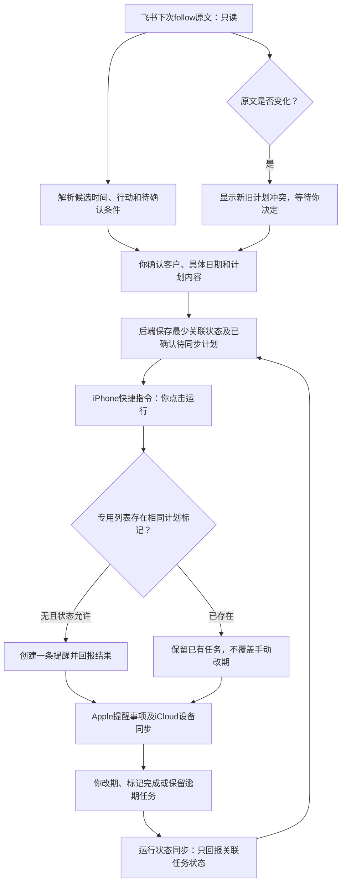

# Apple 提醒事项集成方案（阶段 2 前的设计调整）

> 本文保留为早期方案比较。用户已明确要求自动双向同步及完成回写，最终实现范围以 [最终同步需求](FINAL_SYNC_REQUIREMENTS.md) 为准；本文中半自动推荐和不回写飞书的规则不再是最终要求。

## 结论

推荐先做 **iPhone 快捷指令桥接 + 专用提醒列表 + 手动同步状态**。网页负责理解并确认计划；快捷指令在你的 iPhone 上查找/创建对应提醒。Apple 提醒事项负责持续保存任务、改期及完成，Mac 不需要长期开机。

第一版不承诺全自动双向实时同步。若以后必须在设备无人操作时全天同步，再评估 Mac 本地桥接程序；不要为了少量客户一开始就增加一台全天运行的电脑。

飞书仍是唯一正式客户数据库；Apple 提醒事项是你批准的任务执行工具，后端只保存最少的关联与同步状态。Codex Cloud 没有你的 Apple 提醒事项访问权限，也不能直接调用 Mac/iPhone 的本地接口。

本次只设计，不访问 Apple 账号、创建快捷指令或修改真实待办；保持飞书只读，不读取真实客户记录。

## 官方资料与核实边界

研究日期：2026-10-12，墨尔本。

本次尝试访问以下 Apple 官方文档，但当前云环境网络代理返回 `403 Forbidden`。已保存仅增加 `support.apple.com`、`developer.apple.com` 的网络配置草稿，并保留原有 `open.feishu.cn`；草稿尚需在环境设置保存/发布，重试仍被拦截。因此以下是基于已知平台能力的可行性设计，**不是已在线核实当前系统版本的结论**。不要求现在处理网络设置，也不以此阻止设计交付。

后续必须在你的实际 iOS/macOS 版本上核实：查找提醒是否可检索备注、创建/编辑可用字段、保留已完成记录、访问授权及个人自动化在锁屏和后台时的行为。

官方参考入口：

- [个人自动化简介](https://support.apple.com/guide/shortcuts/intro-to-personal-automation-apd690170742/ios)
- [个人自动化启用与禁用](https://support.apple.com/guide/shortcuts/enable-or-disable-a-personal-automation-apd602971e63/ios)
- [Mac 命令行运行快捷指令](https://support.apple.com/guide/shortcuts-mac/run-shortcuts-from-the-command-line-apd455c82f02/mac)
- [EventKit 开发文档](https://developer.apple.com/documentation/eventkit)
- [iCloud 提醒事项设置](https://support.apple.com/guide/icloud/set-up-reminders-mm0e133ce76c/icloud)

## 方案比较

| 方案 | 自动创建 | 修改/完成同步 | Mac 是否必须开机 | iPhone 单独使用 | 维护与成本 |
| --- | --- | --- | --- | --- | --- |
| iPhone 快捷指令，点击运行 | 可以在获取已确认计划后批量创建；首次和敏感操作可能要求授权 | 运行同步快捷指令时读取专用列表并上报最少状态；不实时 | 不需要 | 可以，但必须运行快捷指令，离线不能获取云端新计划 | 最低维护，无额外快捷指令订阅费；网页后端费用仍存在 |
| iPhone 快捷指令 + 每日个人自动化 | 部分触发器可自动运行，是否无需确认要实机验证 | 定期运行时同步；锁屏、网络、权限、系统调度可能影响 | 不需要 | 可以，但不能当作可靠的全天服务器或保证即时推送执行 | 免费工具，但需处理失败和人工补跑 |
| Mac 快捷指令/本地脚本 + 定时任务 | 电脑唤醒、登录及权限满足时可以定时创建 | 可定期查询变化；睡眠/关机期间停止，不保证即时 | 自动同步期间需要可运行的 Mac | iPhone 可使用已有任务，新任务同步取决于 Mac | 不另买服务器，但有电费、升级和脚本维护 |
| Mac 小型本地桥接程序（EventKit） | 授权后可读取/创建/更新，开发控制更精确 | 可检测本地存储变化并定时核对；iCloud 延迟仍存在 | 自动同步期间需要可运行的 Mac | 可改期/完成，回传等 Mac 恢复运行 | 开发及签名/更新投入更高，不适合第一版 |
| iCloud 网页、非官方 iCloud 接口/密码式集成 | 不推荐当无人值守生产接口 | 稳定性、登录/MFA、接口兼容与权限风险大 | 不一定，但并不因此可靠 | 容易受登录限制 | 不把 Apple ID 密码或应用专用密码交给云程序；不选此方案 |

不把日历订阅或 `.ics` 导入当作等价的提醒事项方案：它们不能保证保留你修改后的任务、读取完成状态和可靠去重。也不引入另一套任务应用作为主入口。

## 第一版日常体验

1. iPhone 网页通过中文键盘听写输入，生成跟进计划并预览。日期明确后由你确认。
2. 网页显示“同步到 Apple 提醒事项”。点击打开已安装的快捷指令；首次配置及系统允许的启动方式要实机验证。
3. 快捷指令从受保护的后端取得你已确认的待同步计划。不要把客户内容、App Secret 或长期访问凭证直接拼入启动网址。
4. 快捷指令仅在指定的“房产客户跟进”列表中查找关联任务，没有才创建；已有则保留并显示同步状态。
5. 你在提醒事项中随时改期、完成或保持未完成。过期不删除，完成后保留 Apple 的已完成记录。
6. 以后录入新计划时，可顺带运行状态核对；另提供一个“同步跟进状态”快捷入口。每日个人自动化是可选便利功能，验证后才启用。

这是“用户确认后的半自动创建”，不是云端自动写入 Apple。若你希望确认后完全不打开快捷指令，需要先验证网页启动与系统授权体验，不能预先保证。

快捷指令需最小可用的服务访问凭证，权限只能获取/回报本人任务，不得直接获得飞书 App Secret，也不能获取整张客户表。设备上凭证的可见性、保存方式及撤销能力需要实机验证，不能把快捷指令配置称为不可提取的密钥保险箱。分享快捷指令前剥离凭证；无法安全持久化时使用每次登录的一次性短期授权。

## 工作流程

Apple/iCloud 在 Mac 与 iPhone 间同步任务和系统后端的状态回传是两件事。两台设备需使用兼容的系统版本、同一 Apple 账号并启用 iCloud 提醒事项；具体系统要求之后核实。电脑上的“在我的 Mac”本地列表不能假定会同步到 iPhone。

## 不重复创建的设计

- 任务依据不透明的稳定计划编号关联，不靠客户姓名或任务标题去重。例如备注末尾 `CRM_PLAN:<随机编号>`，不放飞书密钥；客户姓名相同也不会混淆。
- 专用列表在本地配置时确定；找不到列表时暂停，不自动改写其他列表或新建多个同名列表。
- 查找范围必须包括未完成和已完成任务。任务完成后，不因再次扫描原计划而重建。
- 备注标记是否可靠检索必须验证；如果做不到，先暂停自动创建，改用保守人工核对，不承诺准确去重。
- 后端区分待同步、同步中、已创建、已完成、冲突、结果未知及用户取消状态。为单个计划设执行锁，第一版只允许一个指定设备创建。
- 创建前查找、创建后核验再回报。创建成功但回报失败时，重跑先找标记，不再创建。
- 找到多个相同标记时暂停，不自动删掉任何任务。
- 同时运行、iCloud 延迟和跨设备重复不能仅靠“先搜索再创建”解决。第一版单设备串行运行；阶段 2 原型必须验证失败恢复后才开放使用。
- 如果结果未知且找不到任务，不能断定创建失败；等待同步并让你核对。没有可验证的去重结果时禁止自动重试。
- 你删除任务或移出专用列表后，系统标记“关联丢失”，不能自动重建。你删除备注标记时也暂停核对。

系统不能承诺消除所有分布式操作风险；尤其快捷指令不提供云端事务。可靠性来自单设备、稳定标记、持久化状态及不确定时停止，而不是无限重试。

## 改期、完成与新旧计划的同步规则

| 操作/情况 | 规则 |
| --- | --- |
| 你在 Apple 改日期 | Apple 是当前任务执行日期的权威；后端核对后记录新日期，不用飞书原日期覆盖，也不自动改写飞书 |
| 你修改 Apple 标题、备注 | 保留你的改动；标记缺失时暂停，不靠模糊姓名重新绑定 |
| 到期后未完成 | 提醒持续保留；不删除、不自动换日期。Apple 的逾期展示和通知仍取决于系统设置 |
| 你标记完成 | 后端下一次同步后记录任务完成；同一计划不重建。完成任务不等于已保存客户沟通记录 |
| 飞书原文未变化 | 同一个计划保持不动，保留 Apple 手动改期和完成状态 |
| 飞书原文变化 | 不自动创建第二条或改原任务；显示原文变化与 Apple 当前任务，要求你选择 |
| 你确认只是更新原任务 | 展示 Apple 当前值和将改内容；明确是否保留手动日期。确认后只改获批部分，执行前重新核对 |
| 你确认确实是下一次跟进 | 新计划编号，先决定旧待办继续保留还是由你确认完成；不默认删除旧待办 |
| 新旧两项都应保留 | 由你明确批准独立计划，保留关联说明 |
| 飞书客户删除、不可访问或凭证失效 | 暂停同步并提示；不清理 Apple 任务 |
| Apple 任务已完成但飞书文字未改 | 飞书原文保留，同计划不再创建；是否记录跟进结果属于未来单独确认的飞书写入 |

实际改写前，快捷指令再读取 Apple 当前值；如果你刚手动改了日期，原确认必须失效，重新预览。日期确认、同步许可及任务更新是不同操作，不能用旧授权悄悄覆盖新值。

为了避免冲突，第一版优先只创建和回传状态。计划改变时由你在 Apple 中调整，或明确确认更改后再执行；全自动修改不是首期必须功能。

## 不影响个人待办和隐私

- 使用独立 iCloud 列表，不扫描、修改或上传个人列表。
- 操作逻辑严格限制列表及计划标记，但 Apple 提供的系统权限可能覆盖全部提醒事项；不能声称系统强制按列表隔离。首次授权前说明范围，测试必须验证筛选逻辑。
- 云端只接收绑定任务的编号、日期、完成状态和同步时间；不上传完整个人待办、任意备注或个人列表标题。
- Apple 任务默认采用最少信息：客户显示名/别名、下一步动作；不放电话、详细预算、完整沟通历史。是否用客户真名需你选择，锁屏通知也可能显示内容。
- 不把 Apple ID、密码、飞书 App Secret 放进快捷指令、网址或代码。快捷指令无需直接访问飞书。
- 数据依然可能由 iCloud 存储；使用前需确认账号、同步与隐私设置。

## 成本、运行条件与限制

- 快捷指令和提醒事项是系统自带工具，本方案不需要新增第三方自动化订阅。iCloud 账号及现有容量/地区条件需要核实，不能保证所有用户永远无额外费用。
- 网页/后端依旧需可持续访问；沿用原规划小规模托管预算 AUD 0–25/月，未核实供应商当前报价。AI 提取按量另算，Apple 桥接本身不要求 AI。
- 不需要买设备，不需要 Mac 全天开机，也不部署新的收费服务。
- iPhone 关机、没网络、权限被撤销或没运行同步时，云端状态可能滞后；已有 Apple 任务继续保留。后端显示最后同步时间，不能假装实时。
- iPhone 网页不能直接读取系统提醒事项；快捷指令是受你授权的本地桥梁。
- iPhone 个人自动化不是云端可随意唤起的可靠执行器。完成某条提醒也不能预先假定会触发快捷指令；先采用运行时核对。
- 本地数据库/EventKit 标识不能假设跨设备永远相同。稳定计划标记承担跨设备关联；是否所有字段可编辑和检索要实机验收。
- 将来若需要无人值守分钟级同步，Mac 必须在可运行状态或开发更复杂的 Apple 本地应用；服务器单独运行不能绕过设备授权。

## 阶段 2 的调整与验收

阶段 2 分成两个小交付，先不部署收费服务、不扩大真实飞书权限：

1. 手机网页使用模拟客户，完成中文听写文本、客户匹配、时间确认与计划预览。
2. 建立与真实个人待办分离的模拟提醒列表，验证快捷指令桥接。即使是测试列表，也在你明确同意后才指导本机操作。

必要验收：

- 一条确认计划只创建一项，取消不创建；锁屏/权限/离线行为分别验证。
- 反复运行、创建后回报失败、并发启动不会直接重复创建；结果未知时暂停。
- 已完成项能被查到，不重新创建；逾期未完成项不删除。
- 在 iPhone 手动改期后，重新读飞书不覆盖日期。
- 飞书计划变化需确认，旧未完成项不悄悄消失；客户暂时不可访问也不删除任务。
- 标记丢失、移动列表、重复标记等异常均不自动改个人任务。
- 同一个 iCloud 列表在你的 Mac/iPhone 上按预期同步；Mac 关机时 iPhone 手动同步仍能运行。
- 所有操作只涉及获准测试列表；日志及后端没有个人待办和客户敏感内容。

当前仅完成设计，没有执行上述 Apple 设备功能验收。已有 13 个时间解析测试不证明 Apple 集成功能已可用。

## 下一步待确认

推荐确认“iPhone 快捷指令、点击同步、独立列表、保留 Apple 手动日期、完成状态不自动写飞书”的第一版范围，然后进入阶段 2 模拟网页开发。开始设备桥接之前，只需要确认你的 iOS/macOS 版本及是否启用同账号的 iCloud 提醒事项，不需要提供 Apple 账号或密码。
